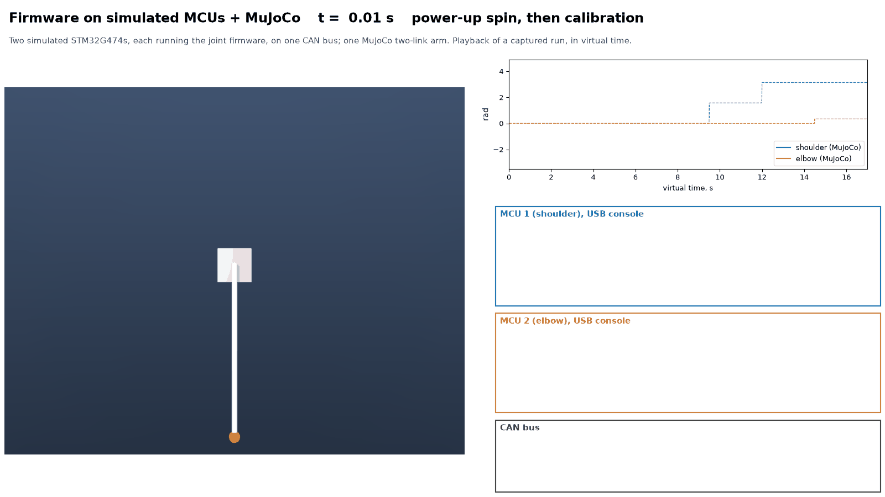
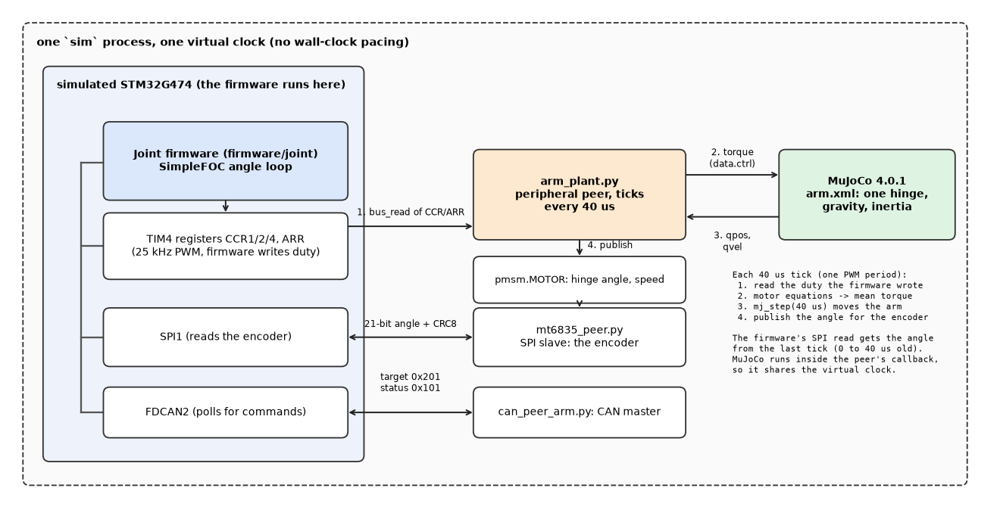
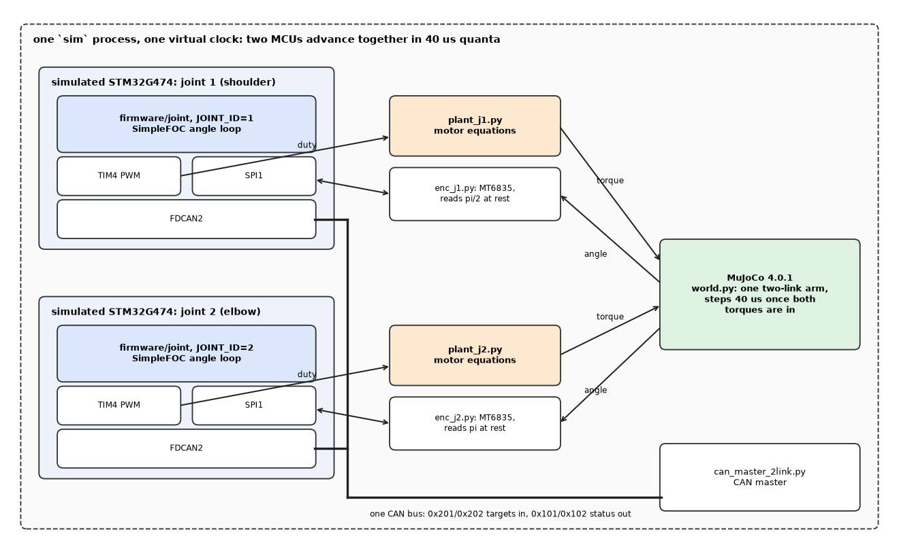
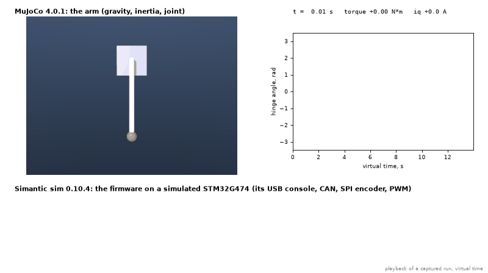
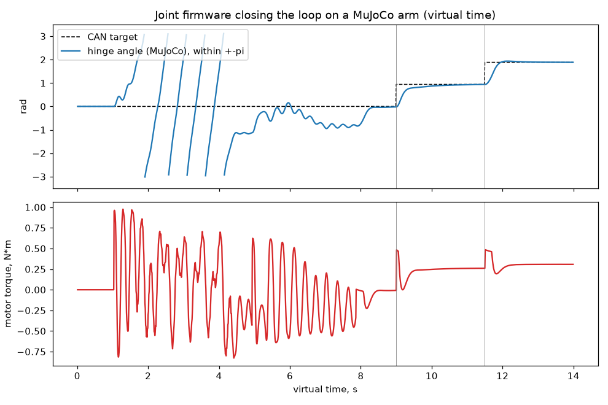
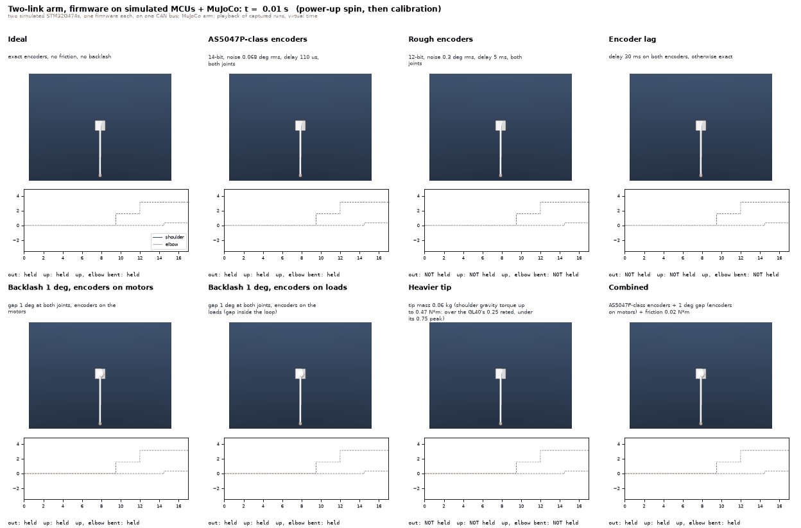
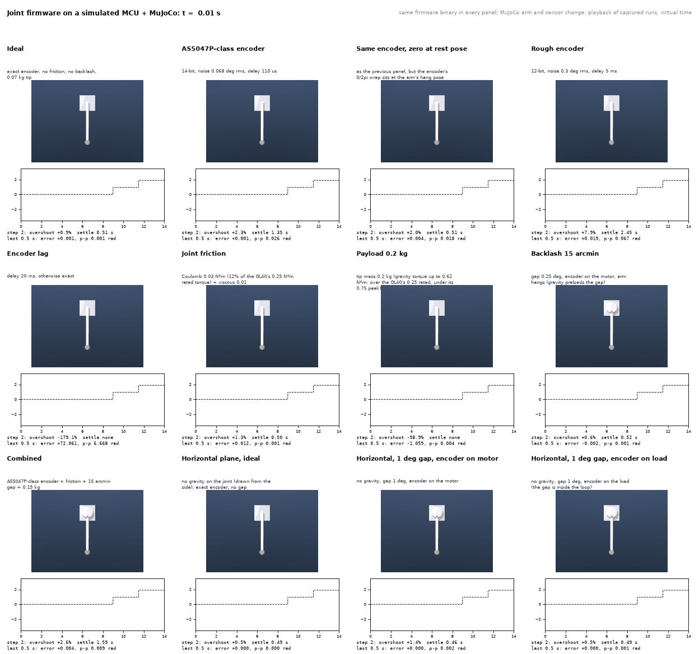

# Firmware on a simulated MCU, in lockstep with a MuJoCo robot

<!-- simantic-banner -->
> **Run this firmware with no hardware.** [Simantic](https://simantic.com) simulates the whole board, peripherals, sensors and buses included. Try it free at **[simantic.com](https://simantic.com)**, or run it locally: `curl -fsSL https://simantic.com/install | sh`


Real motor-control firmware runs on a simulated STM32G474. The physics of the robot it drives come from [MuJoCo](https://mujoco.org).
They are one simulation on one virtual clock: every 40 µs the firmware's PWM becomes a motor torque in MuJoCo, and MuJoCo's joint angle
comes back through a simulated magnetic encoder that the firmware reads over SPI. Nothing is paced by the wall clock, and a run is repeatable
to the byte.



*Two simulated STM32G474s, one per joint, on one CAN bus, driving one MuJoCo two-link arm. At power-up each joint spins itself a couple of
turns on purpose, brakes, then calibrates from wherever it stopped. A CAN master then puts the arm out horizontal, straight up (an inverted
double pendulum), and straight up with the elbow bent. The green ghost is the commanded pose. On the right: each MCU's own USB console,
and the CAN bus, where each joint's firmware reports its measured angle. Playback of a captured run, in virtual time; HD video:
[`sim/screenshots/two-link-hd.mp4`](sim/screenshots/two-link-hd.mp4).*

## How it works



One joint (the parts are what `sim graph --scenario sim/scenario.yaml` prints; the arrows are the data flow of `sim/peers/arm_plant.py`).
Every 40 µs of virtual time, which is one PWM period:

1. The plant peer reads the PWM duty the firmware wrote to TIM4 (`CCR1/2/4` over `ARR`), straight from the simulated timer registers.
2. It turns the duty into phase voltages and integrates the motor's dq currents (ten 4 µs sub-steps), giving a shaft torque.
3. It sets MuJoCo's actuator to that torque and calls `mj_step`, which advances the arm by the same 40 µs.
4. It publishes the joint angle. When the firmware next reads its MT6835 encoder over SPI, the encoder peer answers with that angle (0 to 40 µs old)
   as a 21-bit value with CRC.

MuJoCo runs inside the peer's callback, so it can neither get ahead of nor fall behind the firmware.



The two-link arm is two machines in one scenario (`sim/scenario-2link.yaml`). Each joint's plant peer submits its torque every 40 µs, and MuJoCo
steps once both are in (`sim/peers/world.py`).

| Part | What it is |
| --- | --- |
| Joint firmware (`firmware/joint`) | written for this repository: SimpleFOC 2.4.0 angle loop, MT6835 encoder on SPI1, 3-PWM on TIM4, target angle in and status out on FDCAN2 |
| STM32G474 timers, SPI, FDCAN, clock | modelled by Simantic's `sim` |
| Arm: gravity, inertia, damping, backlash | MuJoCo 4.0.1 (`sim/mujoco/arm.xml`, `sim/mujoco/two_link_xml.py`) |
| Motor | CubeMars GL40 KV210 gimbal motor, from [its published table](https://www.cubemars.com/goods-1132-GL40.html): 14 pole pairs, 0.25 ohm and 90 uH per phase, Kt 0.050 N*m/A, rotor inertia 74 g*cm^2. Switching is averaged per PWM period (`MODELED SIMPLIFICATION`), no cogging |
| Encoder, CAN master | Python peers in `sim/peers` |

## The power-up spin

On purpose, for the demo: before calibrating, the firmware spins its joint open-loop (the field rotated at 6 V, ramped to 12 rad/s), brakes,
then runs SimpleFOC's normal calibration from wherever the arm stopped (`spinShow()` in `firmware/joint/src/main.cpp`; build with `SPIN=0` to
turn it off). Because SimpleFOC counts whole turns, the firmware then takes the rest pose nearest to where the arm is, so it does not unwind
the spin afterwards.



Measured on the one-link arm (`sim/run.sh`, `sim` 0.10.4 build cd27ee45, MuJoCo 4.0.1, 14 s virtual):
- The arm spun 4.8 turns (30.2 rad), stopped, and calibrated: sensor direction CW, pole-pair check OK, `JOINT 1 ready` at 8.063 s.
- Steps to 0.942 rad (at 9.0 s) and 1.885 rad (at 11.5 s): overshoot -0.4% and +0.9% of the step, mean error over the last 0.5 s of each hold
  -0.0059 and +0.0009 rad.



On the two-link arm (`sim/mujoco/run_two_link.py ideal`, 17 s virtual) both joints spun, both passed the pole-pair check, both reported ready at
8.063 s, and the arm held all three poses: largest error over the last 0.5 s of each was 0.005 rad (out), 0.007 rad (straight up) and 0.001 rad
(up, elbow bent).

## Imperfect sensors and mechanics

The same firmware against worse encoders (noise, quantisation, lag; the AS5047P datasheet values as a realistic case), joint friction, a
heavier payload and backlash. Backlash is the standard dead-zone model (Nordin and Gutman, Automatica 38(10), 2002) built as a MuJoCo fixed
tendon on (rotor angle - load angle) with a limited range, so MuJoCo's own constraint solver stops the relative motion at the gap's ends
(`sim/mujoco/lash_check.py` checks it). Each case is a full run of the firmware, scored from MuJoCo's true joint angles, not from what the
firmware sees. Noise uses one fixed seed per case: one sample, not a statistic.

### Two links



| Case | Parameters | Arm out | Straight up | Up, elbow bent |
| --- | --- | --- | --- | --- |
| Ideal | exact encoders, no friction, no backlash | held (0.005 rad) | held (0.007 rad) | held (0.001 rad) |
| AS5047P-class encoders | 14-bit, noise 0.068 deg rms, delay 110 us, both joints (datasheet (AS5047P)) | held (0.011 rad) | held (0.013 rad) | held (0.015 rad) |
| Rough encoders | 12-bit, noise 0.3 deg rms, delay 5 ms, both joints (chosen) | **not held** (0.365 rad) | **not held** (0.383 rad) | **not held** (0.156 rad) |
| Encoder lag | delay 30 ms on both encoders, otherwise exact (chosen) | **whirls away** | **whirls away** | **whirls away** |
| Backlash 1 deg, encoders on motors | gap 1 deg at both joints, encoders on the motors (chosen) | held (0.013 rad) | held (0.016 rad) | held (0.003 rad) |
| Backlash 1 deg, encoders on loads | gap 1 deg at both joints, encoders on the loads (gap inside the loop) (chosen) | held (0.004 rad) | held (0.008 rad) | held (0.001 rad) |
| Heavier tip | tip mass 0.06 kg (shoulder gravity torque up to 0.47 N*m: over the GL40's 0.25 rated, under its 0.75 peak) (chosen) | **not held** (1.293 rad) | **not held** (2.863 rad) | **not held** (2.867 rad) |
| Combined | AS5047P-class encoders + 1 deg gap (encoders on motors) + friction 0.02 N*m (mix of the above) | held (0.020 rad) | held (0.014 rad) | held (0.013 rad) |

"Held": every joint within 0.1 rad of its target over the last 0.5 s of the pose (the number is the largest error). With 30 ms of encoder lag the
inverted arm is thrown away and whirls. With the heavier tip the shoulder's calibration found the wrong direction (`sensor dir: CCW`, pole-pair
estimate 5.47 against 14) and the joint never recovered: an imperfection breaks the firmware's calibration before it breaks the control loop.

### One link



| Case | Parameters | Step 1: overshoot, settle | Step 2: overshoot, settle | Step 2, last 0.5 s: error, peak-to-peak |
| --- | --- | --- | --- | --- |
| Ideal | exact encoder, no friction, no backlash, 0.07 kg tip | -0.4%, 1.51 s | +0.9%, 0.51 s | +0.001, 0.001 rad |
| AS5047P-class encoder | 14-bit, noise 0.068 deg rms, delay 110 us (datasheet (AS5047P, ams-OSRAM)) | +0.0%, 1.61 s | +2.3%, 1.35 s | +0.001, 0.026 rad |
| Same encoder, zero at rest pose | as the previous panel, but the encoder's 0/2pi wrap sits at the arm's hang pose (setup, not a part (firmware built with ENC_REST_ANGLE=0)) | +0.2%, 1.50 s | +2.0%, 0.51 s | +0.004, 0.018 rad |
| Rough encoder | 12-bit, noise 0.3 deg rms, delay 5 ms (chosen) | +1.6%, 2.41 s | +7.9%, 2.45 s | +0.019, 0.067 rad |
| Encoder lag | delay 20 ms, otherwise exact (chosen) | unstable | unstable | arm whirls away (error +72 rad) |
| Joint friction | Coulomb 0.03 N*m (12% of the GL40's 0.25 N*m rated torque) + viscous 0.01 (chosen; Coulomb + viscous is MuJoCo's own model) | -0.4%, 1.49 s | +1.3%, 0.50 s | +0.012, 0.001 rad |
| Payload 0.2 kg | tip mass 0.2 kg (gravity torque up to 0.62 N*m: over the GL40's 0.25 rated, under its 0.75 peak) (chosen) | -9.0%, never | -98.9%, never | -1.059, 0.004 rad |
| Backlash 15 arcmin | gap 0.25 deg, encoder on the motor, arm hangs (gravity preloads the gap) (catalogue: standard planetary 5-15 arcmin) | -0.6%, 1.58 s | +0.6%, 0.52 s | -0.002, 0.001 rad |
| Combined | AS5047P-class encoder + friction + 15 arcmin gap + 0.15 kg (mix of the above) | -0.7%, 1.90 s | +2.6%, 1.59 s | +0.004, 0.009 rad |
| Horizontal plane, ideal | no gravity on the joint (drawn from the side); exact encoder, no gap | +0.9%, 0.47 s | +0.5%, 0.49 s | +0.000, 0.000 rad |
| Horizontal, 1 deg gap, encoder on motor | no gravity, gap 1 deg, encoder on the motor (chosen) | +1.5%, 0.45 s | +1.4%, 0.46 s | +0.000, 0.002 rad |
| Horizontal, 1 deg gap, encoder on load | no gravity, gap 1 deg, encoder on the load (the gap is inside the loop) (chosen) | +0.8%, 0.47 s | +0.5%, 0.49 s | +0.000, 0.001 rad |

*Settle*: time from the command until the true angle stays within 0.02 rad; "never" means not within the 2.5 s hold. *Overshoot* is relative to
the step. "Horizontal" cases have no gravity on the joint, which is where backlash shows (on a hanging arm gravity keeps the gear face
pressed). With the GL40's light rotor (74 g*cm^2) the gap closes in a few milliseconds, and in the horizontal cases the load came to rest
within 0.002 rad of the target with the encoder on either side.

## What this does not test

There is no current sensing and no thermal model: the GL40 is rated 0.25 N*m continuous, and some cases ask for more. The arms are planar
with no contact. The power-up spin is a demo, not a recommended calibration.

## Run it

```sh
# toolchain (PlatformIO) and a Python with MuJoCo
python3 -m venv .venv && .venv/bin/pip install mujoco numpy matplotlib pillow
export PLATFORMIO_CORE_DIR=$PWD/.pio-core          # keeps the toolchain out of ~/.platformio
sh firmware/build.sh                                 # sim/build/joint.elf (SPIN=0 to skip the spin)
VENV=$PWD/.venv sh sim/run.sh                        # one link; sim/out/, sim/screenshots/arm-step.png
JOINT_ID=1 ENC_REST_ANGLE=1.5708f OUT=joint1 sh firmware/build.sh
JOINT_ID=2 ENC_REST_ANGLE=3.14159f OUT=joint2 sh firmware/build.sh
VENV=$PWD/.venv .venv/bin/python sim/mujoco/run_two_link.py ideal
.venv/bin/python sim/mujoco/render_two_link.py two-link ideal
```

`sim` is Simantic's simulator. The checks with no firmware: `python sim/mujoco/swing_check.py` (pendulum period against the analytic one),
`lash_check.py` and `two_link_check.py` (energy conservation of the free double pendulum, backlash gaps).

## Checked against a real STM32G474

The same firmware (a bench build: console on the ST-LINK port, no calibration because nothing is attached) was flashed to a NUCLEO-G474RE
(silicon rev X) and run in the simulator. Clocks, timers and every boot milestone match to within 0.15 ms. The control loop runs 4.5 % faster
in the simulator (10,622 against 10,162 iterations per second). Timing each part of the loop with the Cortex-M cycle counter puts the gap in
plain CPU work from flash (11 to 22 % fast), not in the peripherals (the SPI encoder read is within 0.7 %): the simulator's G474 uses another
STM32's flash and cache timing, unmeasured on the G474 at 170 MHz. The fix is to measure the G474's own flash timing and use it; until then,
read loop rates here as about 4.5 % optimistic. Tables, raw logs and ELF hashes: [`bench/g474-2026-11-18`](bench/g474-2026-11-18/README.md).
