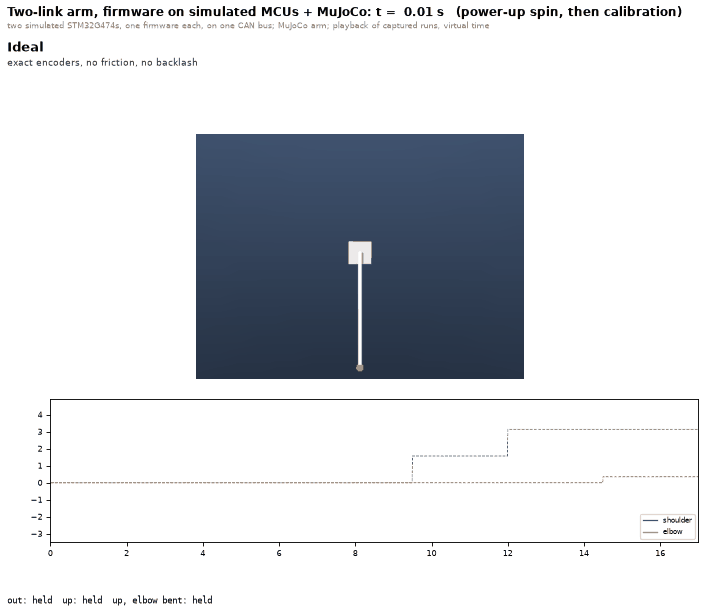

# Firmware on a simulated MCU, in lockstep with a MuJoCo robot

Real motor-control firmware runs on a simulated STM32G474. The physics of the robot it drives come from [MuJoCo](https://mujoco.org).
They are one simulation on one virtual clock: every 40 µs the firmware's PWM becomes a motor torque in MuJoCo, and MuJoCo's joint angle
comes back through a simulated magnetic encoder that the firmware reads over SPI. Nothing is paced by the wall clock, and a run is repeatable
to the byte.



*Two simulated STM32G474s, one per joint, on one CAN bus, driving one MuJoCo two-link arm. At power-up each joint spins itself a couple of
turns on purpose, brakes, then calibrates from wherever it stopped. A CAN master then puts the arm out horizontal, straight up (an inverted
double pendulum), and straight up with the elbow bent. The green ghost is the commanded pose. Playback of a captured run, in virtual time.*

## How it works


One joint (the parts are what `sim graph --scenario sim/scenario.yaml` prints; the arrows are the data flow of `sim/peers/arm_plant.py`).
Every 40 µs of virtual time, which is one PWM period:

1. The plant peer reads the PWM duty the firmware wrote to TIM4 (`CCR1/2/4` over `ARR`), straight from the simulated timer registers.
2. It turns the duty into phase voltages and integrates the motor's dq currents (ten 4 µs sub-steps), giving a shaft torque.
3. It sets MuJoCo's actuator to that torque and calls `mj_step`, which advances the arm by the same 40 µs.
4. It publishes the joint angle. When the firmware next reads its MT6835 encoder over SPI, the encoder peer answers with that angle (0 to 40 µs old)
   as a 21-bit value with CRC.

MuJoCo runs inside the peer's callback, so it can neither get ahead of nor fall behind the firmware.


The two-link arm is two machines in one scenario (`sim/scenario-2link.yaml`). Each joint's plant peer submits its torque every 40 µs, and MuJoCo
steps once both are in (`sim/peers/world.py`).

| Part | What it is |
| --- | --- |
| Joint firmware (`firmware/joint`) | written for this repository: SimpleFOC 2.4.0 angle loop, MT6835 encoder on SPI1, 3-PWM on TIM4, target angle in and status out on FDCAN2 |
| STM32G474 timers, SPI, FDCAN, clock | modelled by Simantic's `sim` |
| Arm: gravity, inertia, damping, backlash | MuJoCo 4.0.1 (`sim/mujoco/arm.xml`, `sim/mujoco/two_link_xml.py`) |
| Motor R, L, flux linkage, pole pairs; averaged switching | stand-ins in the plant peer (`MODELED SIMPLIFICATION`): no particular motor |
| Encoder, CAN master | Python peers in `sim/peers` |

## The power-up spin

On purpose, for the demo: before calibrating, the firmware spins its joint open-loop (the field rotated at 6 V, ramped to 12 rad/s), brakes,
then runs SimpleFOC's normal calibration from wherever the arm stopped (`spinShow()` in `firmware/joint/src/main.cpp`; build with `SPIN=0` to
turn it off). Because SimpleFOC counts whole turns, the firmware then takes the rest pose nearest to where the arm is, so it does not unwind
the spin afterwards.


Measured on the one-link arm (`sim/run.sh`, `sim` 0.10.4 build cd27ee45, MuJoCo 4.0.1, 14 s virtual):
- The arm spun 4.82 turns (30.3 rad), stopped, and calibrated: sensor direction CW, pole-pair check OK, `JOINT 1 ready` at 8.063 s.
- Steps to 0.942 rad (at 9.0 s) and 1.885 rad (at 11.5 s): overshoot -0.7% and +5.4% of the step, mean error over the last 0.5 s of each hold
  -0.0104 and +0.0022 rad. Without the spin the second step overshot +1.2%: calibrating from a different pose gave a different electrical zero.


On the two-link arm (`sim/mujoco/run_two_link.py ideal`, 17 s virtual) both joints spun about two turns, both reported ready at 8.063 s, and the
arm held all three poses: largest error over the last 0.5 s of each was 0.011 rad (out), 0.067 rad (straight up) and 0.003 rad (up, elbow bent).
The shoulder's pole-pair check warned (estimate 5.88 against 7): it calibrates while the elbow's weight swings it.

## Imperfect sensors and mechanics

`sim/mujoco/run_cases.py` (one link, 12 cases) and `sim/mujoco/run_two_link.py` (two links, 8 cases) run the same firmware against worse
encoders (noise, quantisation, lag; the AS5047P datasheet values as a realistic case), joint friction, a heavier payload and backlash
(a MuJoCo tendon-limited gap). Results and the comparison GIFs are being added.

## What this does not test

The motor is a stand-in with no current sensing, so the torque limits are the stand-in's, not a real joint's. The arms are planar with no
contact. The power-up spin is a demo, not a recommended calibration.

## Run it

```sh
# toolchain (PlatformIO) and a Python with MuJoCo
python3 -m venv .venv && .venv/bin/pip install mujoco numpy matplotlib pillow
export PLATFORMIO_CORE_DIR=$PWD/.pio-core          # keeps the toolchain out of ~/.platformio
sh firmware/build.sh                                 # sim/build/joint.elf (SPIN=0 to skip the spin)
VENV=$PWD/.venv sh sim/run.sh                        # one link; sim/out/, sim/screenshots/arm-step.png
JOINT_ID=1 ENC_REST_ANGLE=1.5708f OUT=joint1 sh firmware/build.sh
JOINT_ID=2 ENC_REST_ANGLE=3.14159f OUT=joint2 sh firmware/build.sh
VENV=$PWD/.venv .venv/bin/python sim/mujoco/run_two_link.py ideal
.venv/bin/python sim/mujoco/render_two_link.py two-link ideal
```

`sim` is Simantic's simulator. The checks with no firmware: `python sim/mujoco/swing_check.py` (pendulum period against the analytic one),
`lash_check.py` and `two_link_check.py` (energy conservation of the free double pendulum, backlash gaps).
